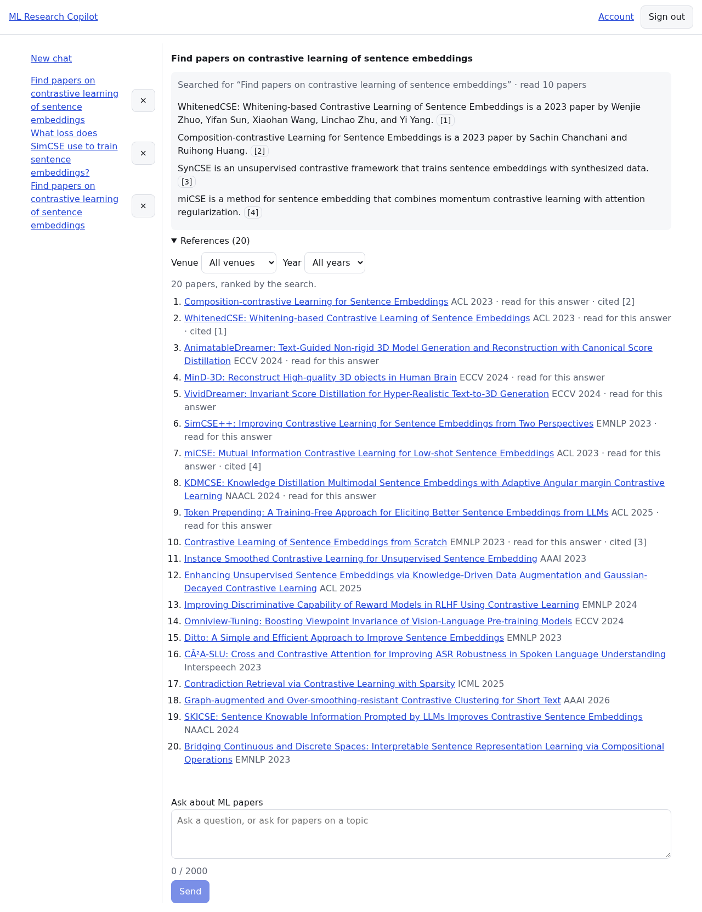
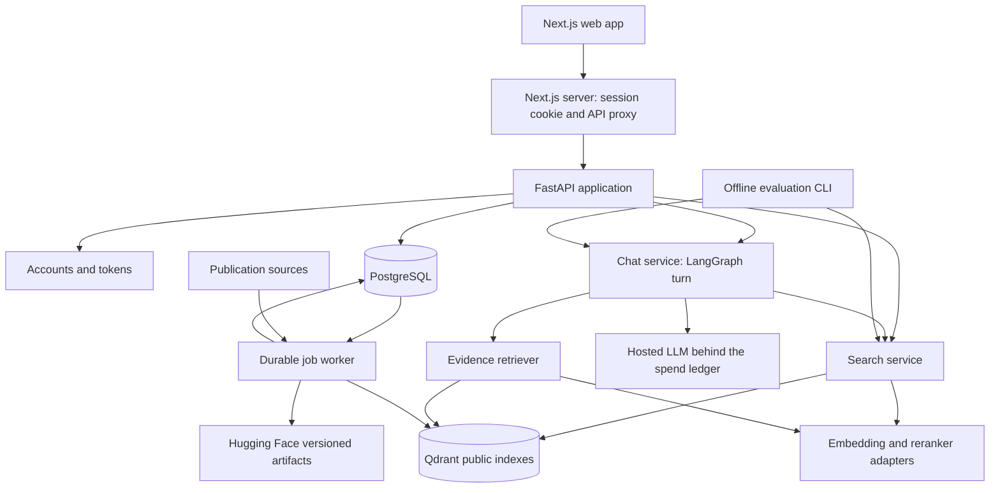

# ML Papers RAG bot

A research assistant that answers questions about ML papers with citations, and lists the
papers each answer read as its References, over **85,729 accepted main-conference
ML papers from 42 venue-years** (AAAI, ACL, CVPR, ECCV, EMNLP, ICCV, ICLR, ICML, IJCAI,
Interspeech, JMLR, NAACL, NeurIPS and WACV, 2023–2026). It runs entirely on one machine: the
databases, the indexes, the embedding model and the reranker are self-hosted, and only answer
generation calls a hosted LLM, under a daily spend cap.

**RAG only, like Consensus (2026-10-15/16).** There is one ask box and no separate search page:
every request, a question or "find me papers about X", is one turn that searches, reads the top
10 papers and answers with cited claims, with the 20 ranked papers listed as References
([plan](docs/superpowers/plans/2026-10-15-rag-only.md)).



*A paper-finding request on the real stack, 2026-10-16 (`reports/u4-single-stage.md`). The answer
cites four sentence-embedding papers; References 3–5 are unrelated 3D-generation papers the
reranker placed there, the known weakness on topic requests measured below.*

## Run it

You need Docker, [uv](https://docs.astral.sh/uv/), Node.js 22 and, for real models, an NVIDIA
GPU. Copy `.env.example` to `.env` and set `DATA_DIR`, which holds every persistent byte,
`DATABASE_URL`, `SECRET_KEY` and, for the chat, `OPENAI_API_KEY` and `LLM_DAILY_SPEND_CAP_USD`.
The corpus and the indexes are built by the pipeline in `CLAUDE.md` (`corpus run`, `search
build-index`, `corpus activate`).

```bash
docker compose --profile core up -d postgres qdrant
uv sync --project backend --frozen --group dev --group models
uv run --env-file .env --project backend alembic -c backend/alembic.ini upgrade head
uv run --env-file .env --project backend python -m copilot.cli search fetch-model
uv run --env-file .env --project backend python -m copilot.cli users create --email you@example.org   # password on stdin; signup is closed
uv run --env-file .env --project backend uvicorn --factory copilot.app:create_default_app --port 8000
cd frontend && npm ci && npm run build && BACKEND_URL=http://127.0.0.1:8000 npm run start   # http://localhost:3000
```

The API warms its search before it accepts requests. With Qdrant just restarted, that took
138 s on this machine; otherwise about 38 s (`reports/m5-drills.md`).

Checks:

```bash
uv run --project backend ruff check backend
uv run --project backend mypy --config-file backend/pyproject.toml backend/src
docker compose --profile test up -d postgres-test qdrant-test
uv run --env-file .env.test --project backend pytest backend/tests -q     # never pass .env to pytest
cd frontend && npm run lint && npm run typecheck && npm test && npm run e2e
```

## How it works

- **Corpus.** The corpus comes from a pinned Hugging Face mirror of the proceedings. Each PDF
  is parsed into heading-aware sections and packed into chunks of about 800 tokens.
  PostgreSQL holds paper identity, chunks, accounts, chats and the job queue. Each corpus
  release is an immutable pair of Qdrant collections (paper abstracts and chunks), with
  BGE-M3 dense vectors and exact BM25 sparse vectors.
- **Search.** BM25 and dense search each find 100 candidates in the chunk collection, and
  each paper is scored by its best chunk. The two lists are fused by reciprocal rank, and
  `bge-reranker-v2-m3` reranks the top 50. Every stage has a deadline; when one is missed, the
  results are marked degraded or the search fails with a typed, retryable error.
- **Answer turn.** Each turn is a LangGraph graph: condense a follow-up into a standalone
  question, search once (the reranker reads each paper's title and the passage that found it),
  read evidence passages inside the top 10 papers, and generate structured claims. Each claim's
  evidence ids are validated before the answer is stored and sent whole over SSE, after a
  `references` event with the 20 ranked papers.
- **Spend ledger.** Every priced LLM call reserves its worst case against a daily cap before
  it is sent.
- **Web app.** One page: `/` is the ask box beside the chat history (sign-in required, since
  every answer spends); each answer shows what it searched, its cited passages and its References
  with venue and year filters. Paper pages are public. A Next.js server keeps the access token in
  an `httpOnly` cookie and proxies the API.



## Measured results

The decision rules were committed before the numbers they decide. Intervals are 95%:
bootstrap over query families for retrieval, Wilson for accuracy.

| What | Result | Evidence |
|---|---|---|
| Retrieval on Open RAG Bench, all 1,914 text questions | `hybrid` nDCG@10 **0.948** [0.936, 0.959] | [orb-text](reports/orb-text.md) |
| Answering on Open RAG Bench, frozen 400, haiku.rag's rubric | **0.880** [0.844, 0.908]. With the chat's `StructuredGenerator` (C4): **0.884** [0.849, 0.912], McNemar p = 0.824, adopted | [orb-text](reports/orb-text.md) |
| Follow-up answering, 43 frozen ORB conversations (C7) | condensed **0.791** [0.648, 0.886], raw 0.674 [0.525, 0.795], standalone ceiling 0.930; McNemar p = 0.227, so C7's rule turned condensing off; the developer turned it **on** again (2026-10-14) on this underpowered but one-directional evidence | [chat-followups](reports/chat-followups.md) |
| The one first stage on our corpus (U4), validation, model-written queries | Passage questions (S1, 190): reranker reading title + passage nDCG@10 **0.698**, reading title + abstract 0.350. "Find papers" requests (S3, 349): title + passage **0.563**, title + abstract **0.663** (−0.100 [−0.130, −0.070]). Shipped: title + passage, the developer's choice; each set leans toward the reader of its source text | [u4-single-stage](reports/u4-single-stage.md) |
| Failure drills on the local stack (R3) | 7 of 8 pass, 1 not possible; one failure found and fixed | [m5-drills](reports/m5-drills.md) |

## Limitations

- **The judges are models.** In place of hand labels, a second model judge checked the judge
  of record: agreement 95.5%, κ 0.807 on 89 cases. That is weaker evidence than human labels.
- **Some test questions are synthetic.** The follow-up conversations, S1's 571 passage
  questions and S3's 1,048 topic queries were written by a model. Each has one gold paper, so a
  question that many papers answer is undercounted.
- **Paper-finding ranks worse than it could.** The reranker reads the passage that found each
  paper, which serves questions well, but on topic requests the old abstract reader ranked the
  source paper higher (S3, above), and the real-stack walk shows unrelated papers in a topic
  request's top 5. A fairer judged measurement is the open follow-up.
- **3,802 papers (4.4%) have no full text.** 3,759 of them are zero-byte PDFs at the source,
  mostly NeurIPS 2025 and ICLR 2026 (`docs/data-card.md`). They have no chunks, and the
  shipped search finds papers through the chunk collection, so search cannot return them.
- **The GPU is shared** with other workloads on this machine. Timing evidence is taken only
  on an idle GPU; under contention, search degrades within its deadlines.
- **It runs locally only.** Staged deployment, public rate limits and per-user quotas are
  deferred, not built. If Qdrant restarts while the API runs, the first searches are cold
  again; and after a fresh start the warm-up can report ready while the first live searches still
  time out a branch (`reports/u4-single-stage.md`).

More: [the case study](docs/case-study.md), [the data card](docs/data-card.md), the design spec
in `docs/superpowers/specs/`, and the task and gate board in `docs/superpowers/progress.md`.
