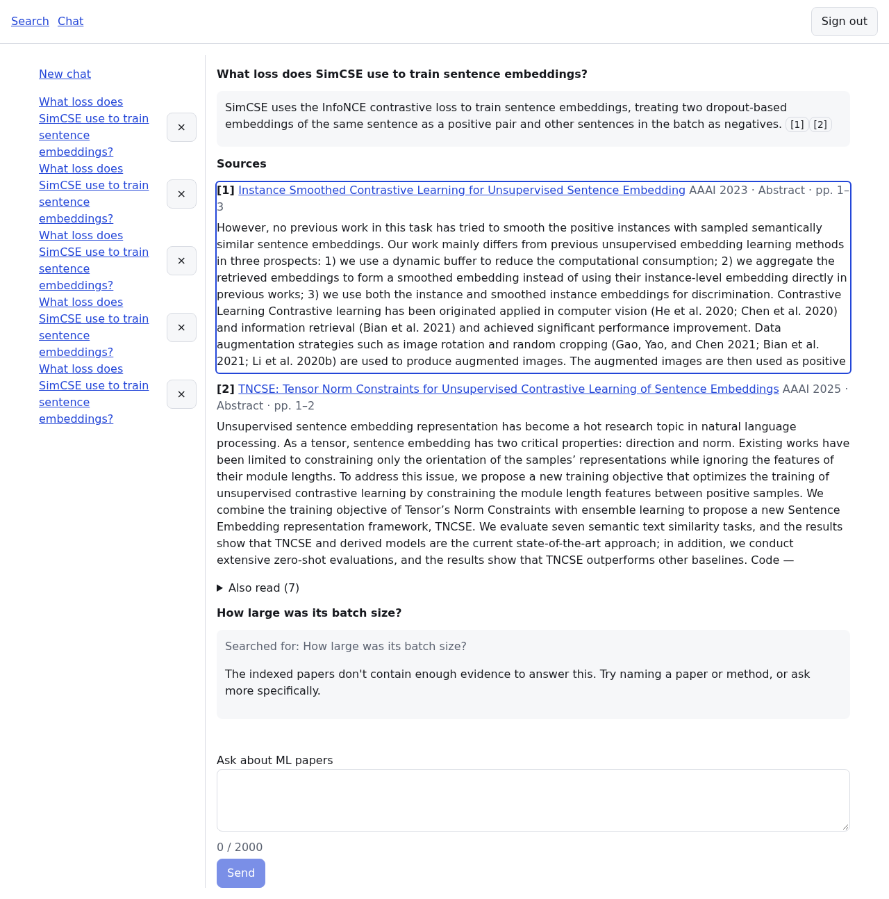
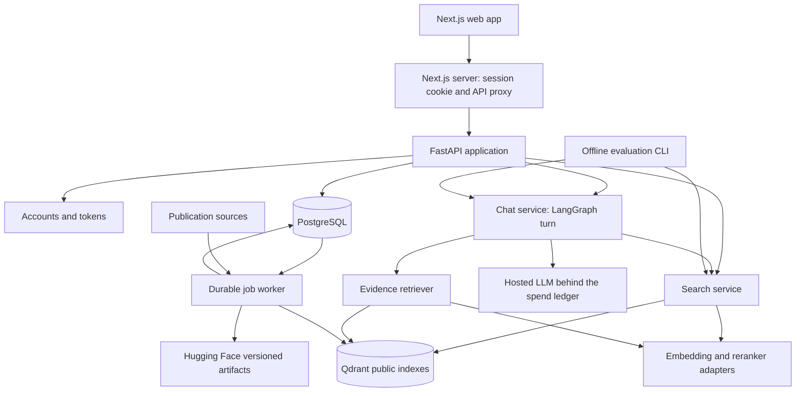

# ML Papers RAG bot

Paper search and a chatbot that answers with citations, over **85,729 accepted main-conference
ML papers from 42 venue-years** (AAAI, ACL, CVPR, ECCV, EMNLP, ICCV, ICLR, ICML, IJCAI,
Interspeech, JMLR, NAACL, NeurIPS and WACV, 2023–2026). It runs entirely on one machine: the
databases, the indexes, the embedding model and the reranker are self-hosted, and only answer
generation calls a hosted LLM, under a daily spend cap.



*The chat on the real stack (`reports/m4-web.md`). Each claim cites the passages it rests on.
A follow-up the indexed papers cannot answer gets "not enough evidence", not a guess.*

## Run it

You need Docker, [uv](https://docs.astral.sh/uv/), Node.js 22 and, for real models, an NVIDIA
GPU. Copy `.env.example` to `.env` and set `DATA_DIR`, which holds every persistent byte,
`DATABASE_URL`, `SECRET_KEY` and, for the chat, `OPENAI_API_KEY` and `LLM_DAILY_SPEND_CAP_USD`.
The corpus and the indexes are built by the pipeline in `CLAUDE.md` (`corpus run`, `search
build-index`, `corpus activate`).

```bash
docker compose --profile core up -d postgres qdrant
uv sync --project backend --frozen --group dev --group models
uv run --env-file .env --project backend alembic -c backend/alembic.ini upgrade head
uv run --env-file .env --project backend python -m copilot.cli search fetch-model
uv run --env-file .env --project backend python -m copilot.cli users create --email you@example.org   # password on stdin; signup is closed
uv run --env-file .env --project backend uvicorn --factory copilot.app:create_default_app --port 8000
cd frontend && npm ci && npm run build && BACKEND_URL=http://127.0.0.1:8000 npm run start   # http://localhost:3000
```

The API warms its search before it accepts requests. With Qdrant just restarted, that took
138 s on this machine; otherwise about 38 s (`reports/m5-drills.md`).

Checks:

```bash
uv run --project backend ruff check backend
uv run --project backend mypy --config-file backend/pyproject.toml backend/src
docker compose --profile test up -d postgres-test qdrant-test
uv run --env-file .env.test --project backend pytest backend/tests -q     # never pass .env to pytest
cd frontend && npm run lint && npm run typecheck && npm test && npm run e2e
```

## How it works

- **Corpus.** The corpus comes from a pinned Hugging Face mirror of the proceedings. Each PDF
  is parsed into heading-aware sections and packed into chunks of about 800 tokens.
  PostgreSQL holds paper identity, chunks, accounts, chats and the job queue. Each corpus
  release is an immutable pair of Qdrant collections (paper abstracts and chunks), with
  BGE-M3 dense vectors and exact BM25 sparse vectors.
- **Search.** BM25 and dense search each find 100 candidates in the chunk collection, and
  each paper is scored by its best chunk. The two lists are fused by reciprocal rank, and
  `bge-reranker-v2-m3` reranks the top 50. Every stage has a deadline; when one is missed, the
  results are marked degraded or the search fails with a typed, retryable error.
- **Chat.** Each turn is a LangGraph graph: optionally condense the question (off since C7),
  search for 10 papers, retrieve evidence passages inside them, and generate structured
  claims. Each claim's evidence ids are validated before the answer is stored and sent whole
  over SSE.
- **Spend ledger.** Every priced LLM call reserves its worst case against a daily cap before
  it is sent.
- **Web app.** A Next.js app keeps the access token in an `httpOnly` cookie and proxies the
  API.



## Measured results

The decision rules were committed before the numbers they decide. Intervals are 95%:
bootstrap over query families for retrieval, Wilson for accuracy.

| What | Result | Evidence |
|---|---|---|
| Paper retrieval, G2 locked test on LitSearch's own corpus (118 queries) | `hybrid_rerank` nDCG@10 **0.550** [0.473, 0.621] | [m2-locked-test](reports/m2-locked-test.md) |
| Paper retrieval on our corpus, LitSearch's in-domain test slice (48 queries) | `hybrid_rerank` nDCG@10 **0.582** [0.467, 0.704] | [m2-locked-test](reports/m2-locked-test.md) |
| Retrieval on Open RAG Bench, all 1,914 text questions | `hybrid` nDCG@10 **0.948** [0.936, 0.959] | [orb-text](reports/orb-text.md) |
| Answering on Open RAG Bench, frozen 400, haiku.rag's rubric | **0.880** [0.844, 0.908]. With the chat's `StructuredGenerator` (C4): **0.884** [0.849, 0.912], McNemar p = 0.824, adopted | [orb-text](reports/orb-text.md) |
| Follow-up answering, 43 frozen ORB conversations (C7) | condensed **0.791** [0.648, 0.886], raw 0.674 [0.525, 0.795], standalone ceiling 0.930; McNemar p = 0.227, so by the rule condensing is **off** (underpowered) | [chat-followups](reports/chat-followups.md) |
| What the search page's reranker reads (S2, 190 passage questions + 52 paper-level) | title + chunk gains **+0.348** [+0.292, +0.408] nDCG@10 on passage questions but fails the paper-level guard (−0.065 [−0.167, +0.044]), so it keeps reading **abstracts** | [m5-rerank-text](reports/m5-rerank-text.md) |
| Failure drills on the local stack (R3) | 7 of 8 pass, 1 not possible; one failure found and fixed | [m5-drills](reports/m5-drills.md) |

## Limitations

- **The judges are models.** In place of hand labels, a second model judge checked the judge
  of record: agreement 95.5%, κ 0.807 on 89 cases. That is weaker evidence than human labels.
- **Some test questions are synthetic.** The follow-up conversations and S1's 571 passage
  questions were written by a model. Each has one gold paper, so a question that many papers
  answer is undercounted.
- **3,802 papers (4.4%) have no full text.** 3,759 of them are zero-byte PDFs at the source,
  mostly NeurIPS 2025 and ICLR 2026 (`docs/data-card.md`). They have no chunks, and the
  shipped search finds papers through the chunk collection, so search cannot return them.
- **The GPU is shared** with other workloads on this machine. Timing evidence is taken only
  on an idle GPU; under contention, search degrades within its deadlines.
- **It runs locally only.** Staged deployment, public rate limits and per-user quotas are
  deferred, not built. If Qdrant restarts while the API runs, the first searches are cold
  again.

More: [the case study](docs/case-study.md), [the data card](docs/data-card.md), the design spec
in `docs/superpowers/specs/`, and the task and gate board in `docs/superpowers/progress.md`.
