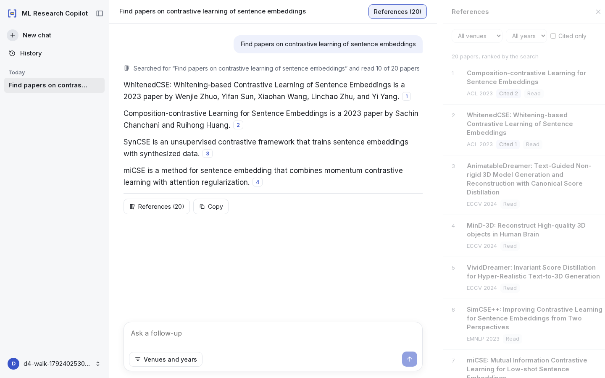

# ML Papers RAG bot

A research assistant that answers questions about machine-learning papers with cited claims, over
**85,729 accepted main-conference papers from 42 venue-years** (AAAI, ACL, CVPR, ECCV, EMNLP,
ICCV, ICLR, ICML, IJCAI, Interspeech, JMLR, NAACL, NeurIPS and WACV, 2023–2026).

Every request, a question or "find me papers about X", is answered by a research agent. It searches
the corpus (up to three times), reads passages inside the top papers, and writes short claims, each
citing the passage it rests on. The papers it ranked are listed as the answer's References. Follow-up
questions can be answered from passages the conversation already cited.

Everything runs on one machine: PostgreSQL, Qdrant, the embedding model and the reranker are
self-hosted. Only answer generation calls a hosted LLM, under a daily spend cap.



## Features

- **Cited answers.** Each claim names the passages it rests on; ids are validated before an answer
  is stored, and a claim's passages open highlighted beside it.
- **Hybrid search.** BM25 and BGE-M3 dense retrieval over 3.4 M chunks, fused by reciprocal rank and
  reranked by a cross-encoder reading each paper's title, abstract and the passage that found it.
- **A research agent.** A LangGraph tool loop that writes its own queries, may search again or read a
  whole section, and may answer a follow-up from earlier passages without searching. Every search
  it runs is shown above the answer.
- **Accounts and history.** Sign-in by an emailed code; chats, ratings, usage, and deletion of chats
  or the account. 20 answers a day per account.
- **Bounded spend.** Every priced LLM call reserves its worst case against a daily cap first.
- **Reproducible evaluation.** Pinned datasets, decision rules committed before their numbers, test
  sets scored once, paired statistics.

## Results

Measured on this stack; intervals are 95%. Details and method in [docs/results.md](docs/results.md).

| | Result |
|---|---|
| Retrieval, Open RAG Bench (1,914 questions) | nDCG@10 **0.948** [0.936, 0.959], MRR@5 0.937 |
| Answering, Open RAG Bench frozen 400 | agent **0.890**, pipeline 0.890 (same run) |
| Multi-turn, MTRAG ClapNQ test (24 conversations) | agent **0.636**, pipeline 0.588 (p 0.16) |
| Multi-turn, MTRAG Govt test (214 turns) | agent **0.556**, pipeline 0.528 |
| Multi-hop, MultiHop-RAG test (150) | agent **0.767**, pipeline 0.720 (p 0.23) |
| Agent cost and speed (Govt) | $0.0015 and 7.3 s per turn (p50), about 2× and 1.5× the pipeline |

## Quick start

You need Docker, [uv](https://docs.astral.sh/uv/), Node.js 22, an NVIDIA GPU and an OpenAI API key.

```bash
cp .env.example .env              # set DATA_DIR, SECRET_KEY, OPENAI_API_KEY, LLM_DAILY_SPEND_CAP_USD
docker compose --profile core up -d postgres qdrant mailpit
uv sync --project backend --frozen --group dev --group models
uv run --env-file .env --project backend alembic -c backend/alembic.ini upgrade head
uv run --env-file .env --project backend python -m copilot.cli search fetch-model
# build the corpus and its indexes: see docs/setup.md
uv run --env-file .env --project backend uvicorn --factory copilot.app:create_default_app --port 8000
cd frontend && npm ci && npm run build && BACKEND_URL=http://127.0.0.1:8000 npm run start
```

Open http://localhost:3000 and sign in with the code from the Mailpit inbox at
http://127.0.0.1:8025. The full guide, including building the corpus, is [docs/setup.md](docs/setup.md).

## Documentation

| | |
|---|---|
| [Architecture](docs/architecture.md) | Corpus pipeline, search, the agent's turn, spend ledger, layout |
| [Setup](docs/setup.md) | Configure, build the corpus, run, test, operate |
| [Evaluation](docs/evaluation.md) | Datasets, method, and how to rerun every experiment |
| [Results](docs/results.md) | Every measured number |
| [Case study](docs/case-study.md) | The decisions and the evidence behind each |
| [Data card](docs/data-card.md) | What the corpus is, where it comes from, what it excludes |
| [Judge rubric](docs/judge-rubric.md) | How answers are scored |

## Repository layout

```
backend/     Python package `copilot`: API, worker, corpus pipeline, search, agent, evaluation
frontend/    Next.js web app
configs/     runtime settings and registered experiments
prompts/     versioned prompts, pinned by digest
data/        dataset ids, labels and splits (no third-party text)
docs/        documentation
infra/       container image
```

## Limitations

- **The judges are models.** Answer accuracy is an LLM's verdict against each dataset's reference,
  checked against a second model (κ 0.807), not human labels.
- **The agent was adopted over its tests.** It was ahead on the multi-turn and multi-hop sets but
  never by a statistically clear margin, and costs about twice as much per turn.
- **3,802 papers (4.4%) have no full text**, mostly zero-byte PDFs at the source; search cannot
  return them ([data card](docs/data-card.md)).
- **Local only.** Staged deployment, public rate limits and row-level security are not built. After
  a Qdrant restart the first searches can time out while the index warms.

## Licence

Code: [MIT](LICENSE). The corpus papers, and the evaluation datasets (Open RAG Bench CC-BY-NC-4.0,
MTRAG CC-BY-SA-4.0, MultiHop-RAG ODC-BY), keep their own licences; none of their text is in this
repository.
