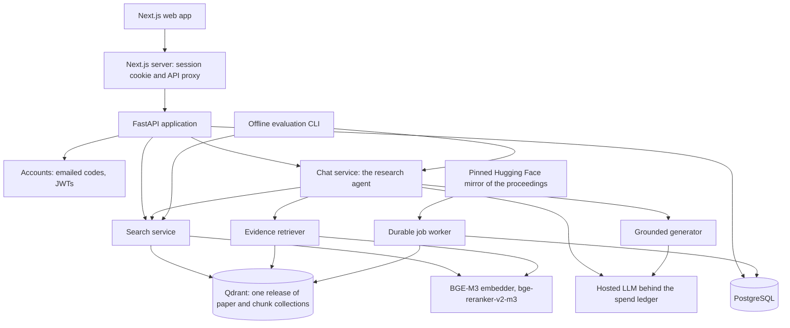

# Architecture

One modular Python application (FastAPI) plus one durable worker process, a Next.js web app, and
two self-hosted stores. Only answer generation calls a hosted LLM; everything else runs on one
machine.



## Corpus pipeline

`backend/src/copilot/corpus/`, `jobs/`

1. **Mirror.** A pinned Hugging Face mirror supplies the registry of accepted papers and their
   PDFs (OpenReview's guest API refuses automated access). Membership is read from each record's
   own venue label: main-conference tracks only, matched positively.
2. **Identity.** Each paper gets a generated UUID; external ids are aliases, merges are redirects,
   and contradictory strong-id collisions are held as conflicts rather than guessed.
3. **Parse and chunk.** PDFs are parsed into heading-aware sections with page spans. Paragraphs
   are inferred (the extracted text has no blank lines) and packed into ~800-token chunks counted
   in the pinned BGE-M3 tokenizer, with a two-sentence overlap (`paragraph-pack-v1`).
4. **Release.** A snapshot is exported to Parquet and indexed into an immutable pair of Qdrant
   collections (paper abstracts, chunks) with BGE-M3 dense vectors and exact BM25 sparse vectors.
   The active-release pointer switches only after count, dimension, checksum and canary checks.

The worker leases jobs transactionally (`SKIP LOCKED`, idempotency keys, heartbeats), and the
venue-by-venue runner deletes each venue-year's PDFs once its text is stored, so peak disk is one
venue-year rather than the whole corpus.

## Search

`backend/src/copilot/search/`, `configs/search.yaml`

BM25 and dense search each take 100 candidates from the **chunk** collection, one hit per paper
by its best chunk. Reciprocal rank fusion (`sum 1/(60 + rank)`) runs in application code, and
`bge-reranker-v2-m3` reranks the top 50 reading each paper's title, abstract and the passage that
found it. Every stage has a deadline; a missed one degrades the result explicitly or fails with a
typed, retryable error. On startup the API warms every stage before it accepts requests.

## Chat turn

`backend/src/copilot/chat/`, `agent/`, `evidence/`, `models/generation.py`, `configs/chat.yaml`

The research agent, a two-node LangGraph loop (model ⇄ tools):

- **Tools:** `search_papers` (the search above, then evidence passages inside the top 10 papers;
  at most 3 searches), `read_section` (widen a passage to its section; at most 4), `answer`
  (the question being answered and the ids of the passages that answer it). At most 8 model calls.
- **Memory:** the last 3 exchanges, and up to 12 passages earlier answers in the chat cited, which
  a follow-up may be answered from without searching. A first question is searched as written.
- **Answer:** the chosen passages (then every other passage seen, within a 6,000-token budget) go
  to the grounded generator, which returns structured claims, each naming the evidence ids it
  rests on. Ids are validated structurally; a bad answer gets one repair, then insufficiency.
- **Streaming:** server-sent events: `status` per search (with its query), `references` (every
  query and the papers they ranked, merged), `evidence`, `final` with the stored message. The
  answer is stored before `final` is sent.

Optional, off: a planning step before the loop, and a self-check after the answer (see
[results](results.md)). `chat/pipeline.py` (condense → one search → answer) served until the agent
replaced it and remains the evaluation baseline.

## Spend ledger

`backend/src/copilot/models/spend.py`, `configs/llm.yaml`

Every priced call reserves its worst case in the `llm_calls` table under a daily cap before it is
sent, and settles to its real cost afterwards. Evaluation runs also take a per-run budget: refused
at their worst case, stopped once their ledger spend passes it.

## Accounts and data

`backend/src/copilot/identity/`, `chat/store.py`

Sign-in is by a six-digit code sent by email (Mailpit locally); the API issues JWTs and the
Next.js server keeps them in an `httpOnly` cookie. Identity comes only from a verified token.
Chats, messages, the passages each answer saw and its References are stored per user; a user can
rate answers, see usage, and delete all chats or the account. 20 answers a day per account.

## Web app

`frontend/` (Next.js 16, TypeScript strict)

One ask box beside the chat history. Each answer shows what it searched, its cited passages
(highlighted in a side panel) and its References with venue and year filters. Paper pages are
public; asking requires sign-in, since every answer spends.

## Evaluation

`backend/src/copilot/evaluation/`, `configs/experiments/`. See [evaluation](evaluation.md).

## Layout

```
backend/src/copilot/
  agent/       research agent: graph, tools, turn, planning, self-check
  chat/        chat API, service (SSE), store, served agent, baseline pipeline
  corpus/      mirror, ingest, parse, chunk, export, releases
  evidence/    evidence retrieval and citation validation
  evaluation/  datasets, runners, judge, pairing, metrics
  identity/    codes, tokens, users, mail
  jobs/        durable queue and worker
  models/      embeddings, reranker, LLM clients, generation, spend ledger
  search/      lexical, dense, fusion, rerank, service, API
  cli.py       every offline command
backend/migrations/   Alembic migrations
configs/              runtime settings and experiment registrations
prompts/              versioned prompts, pinned by digest
data/fixtures/        ids, labels and splits of every dataset; no third-party text
frontend/             Next.js web app and its unit and browser tests
infra/, compose.yaml  container images and services
```
