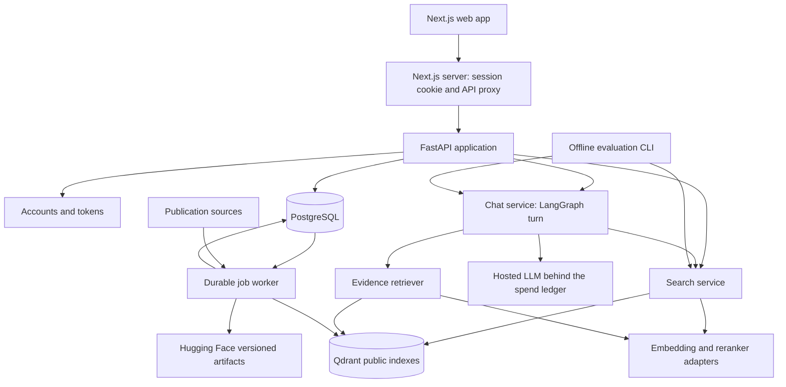

# ML Research Copilot — Technical Specification

Date: 2026-09-05; revised 2026-10-11 (scope narrowed to paper search and grounded chat, see §1). Status: M1 and M2 are implemented; the revised M3–M5 are planned in `docs/superpowers/plans/2026-10-11-*.md`.

## 1. Intent and scope

**Revision 2026-10-15: RAG only, like Consensus.** The developer decided there is no separate search mode. Every request, including "find me papers about X", goes through one turn that searches, reads the top papers and answers with citations; the papers it read are shown with the answer as its References. One retrieval configuration serves the turn: the chat's measured first stage, with the reranker reading title + passage. Plan: `docs/superpowers/plans/2026-10-15-rag-only.md` (M6, reassigned; U1–U4; gate G6, reassigned). Until U3 lands, the code still serves the search page and the chat separately. Where this section, §7, §10 or §11 describe a public search page, that describes the code as built, not the decided product.

**Revision 2026-10-11.** The developer narrowed the product to two things, modelled on Consensus and haiku.rag: **paper search** over the corpus, and **a chatbot that answers questions about ML papers from their text**, every claim citing the passages it rests on, in multi-turn conversations kept as history for signed-in users. Recommendations (§8), the library and preferences, private uploads, the general-knowledge chat mode, the research agent, paper comparison and all of M6 (§13) are removed. Text below that described only them now says so; text that still governs something stays. The developer's answers that shape the revision: haiku.rag-style multi-turn chat citing passages; accounts with chat history; the existing corpus only; a Next.js web app; one search per turn; local only, deployment decided later; LangChain where it fits (LangGraph for the chat turn, a LangChain retriever adapter, `ChatOpenAI` structured output in the generator); the live-search reranker decision as a plan task; evaluation at the current standard; chat backend first.

Confirmed intentions: land a machine learning engineer role specializing in retrieval and recommendation; learn how the system works; attract researchers as real users. Support topic exploration, related-work discovery, and keeping up with research. The developer is the first test user. Confirmed budget constraints: the infrastructure budget is zero and permanent — PostgreSQL, Qdrant and file storage are self-hosted via Docker on the developer's own Windows machine — with the hosted LLM/multimodal generation API as the single named exception, funded personally by the developer. The project is portfolio-scoped, not production-scoped, for now. No time budget, GPU availability, research specialty, or launch date has been supplied.

This specification translates the [original proposal](C:/Users/hongp/Documents/Phuc/Projects/ml_rag_bot_recommender/ml_research_copilot_project_proposal.md) into a staged product. Unconfirmed choices below are design defaults, not requirements attributed to the user. The accompanying plans are drafts requested by the user; writing them does not authorize implementation or cloud spending.

The product loop (revised 2026-10-15) is: ask, whether a question or a request for papers → read a cited answer and the References it was built from → open the papers and passages → ask a follow-up. Every turn invokes the LLM, under the daily spend cap. Superseded 2026-10-15: "search for papers, or ask a question", with a search page that never invoked an LLM. Superseded: the earlier loop ended in a recommendation feed built from saved and dismissed papers.

### Alternatives considered

| Approach | Benefit | Cost | Decision |
|---|---|---|---|
| Retrieval and recommendation core with a thin research UI | Produces measurable ML work and an early personal feedback loop | Rich chat arrives after search | Recommended |
| Chat and PDF assistant first | Quick conversational demonstration | Ranking and recommendation experiments arrive late | Preserve these features in milestone 4 |
| Full original architecture immediately | Broad feature coverage | Many services and integration risks before evidence of utility | Stage the architecture across milestones |

### Releases

| Release | User outcome | Required capability |
|---|---|---|
| M1 Corpus foundation | Inspect a reproducible paper dataset | Normalize, deduplicate, parse, track provenance, export snapshots |
| M2 Search laboratory | Find papers and measure ranking quality | BM25, dense, hybrid, reranking, benchmark harness, search API |
| M3 Grounded chat backend (revised 2026-10-11) | Sign in and hold a multi-turn conversation answered from the corpus, every claim citing passages | Self-hosted accounts, chat history, a LangGraph turn (condense → one search → evidence → validated claims), SSE streaming; answering measured on ORB single-turn and follow-up conversations |
| M4 Web app (revised) | Search, read papers and chat in a browser | Next.js search, paper, login and chat pages; cookie session behind a server-side proxy; browser and accessibility tests |
| M5 Search upgrade and portfolio release (revised; partially deferred) | Trust the product running locally | The search reranker's text decided on our corpus; request logs and cost reports; account deletion; backup and restore; failure drills; case study. Staged deployment, recovery drills, public rate limits and per-user quotas deferred |
| M6 Research expansion | Removed 2026-10-11 | — |
| M6 One RAG experience (number reassigned 2026-10-15) | Ask anything in one box and get a cited answer with its References | One retrieval configuration; References from the turn's own ranking; an answer form for paper-finding requests; one page; the single first stage measured on S1 and S3 (plan `2026-10-15-rag-only.md`) |

Revised 2026-10-11: the portfolio deliverable is M1–M5 as revised, with M5's deployment half deferred (plans `2026-10-11-chat-backend.md`, `2026-10-11-web-app.md`, `2026-10-11-search-upgrade-and-release.md`). The paragraph that follows is the earlier definition, kept for its deferral rule, which still holds. Earlier: the portfolio MVP is M1–M4 plus the free-tier-compatible subset of M5: deterministic CI (P5.1), tracing and LLM cost tracking (P5.2), the account-deletion lifecycle and a local backup/restore from P5.3 (both run on the local stack at no cost), the local isolation and failure tests (P5.4), and the case study (P5.5). The remainder of M5 — staged deployment onto rented infrastructure, RPO/RTO recovery drills, managed backup targets, and rate limiting whose purpose is protecting a paid public deployment from strangers' traffic — is deferred and not required for the portfolio deliverable; it is revisited only if a future recorded decision funds a public deployment. Superseded: earlier revisions defined the MVP as M1–M5 in full. M3 moves basic personalization earlier because recommendation is a stated career focus. M6 contains V2/V3 extensions. No feature is implicitly required before its release. Automatic emails, billing, collaboration, and mobile applications are outside this design.

## 2. Global constraints

These lines are copied into every implementation plan.

- Python 3.12; Node.js 22; TypeScript strict mode; UTF-8 files; UTC timestamps.
- Lock Python and JavaScript dependencies; pin container images and model revisions before benchmark or deployment runs.
- Hugging Face is an offline corpus/artifact destination and is never queried during user requests.
- Public corpus data and private user documents use separate Qdrant collections and storage namespaces.
- Derive user identity from a verified token; never trust a client-supplied user_id.
- All benchmark runs record corpus, split, model, configuration, code, hardware, and seed versions.
- No paid cloud resources, public publishing, or application implementation occur while preparing these documents.
- Postgres and Qdrant are self-hosted via Docker on the developer's own machine by default; no managed database, vector, or storage subscription is used unless a future, explicitly-recorded decision changes this.
- All persistent local data lives under one configurable root directory, default `C:\ml-copilot-data\` on the developer's machine, so the entire dataset can be deleted by removing that directory.
- The hosted LLM/multimodal generation API is the one paid resource in the project, funded personally by the developer; its cost tracking and daily spend cap from P5.2 remain required because real personal money is involved.

Version numbers above are project compatibility choices, not claims about the latest releases. Choose exact maintained package versions by resolver and compatibility tests in P1.1; record them in lockfiles. Avoid speculative package pins in a design document. Default local execution uses Docker Desktop Linux containers; PowerShell commands must work from the repository root. No Bash-only scripts in the critical development path.

## 3. Architecture and boundaries

Revised 2026-10-11: no recommendation service, private uploads or private file storage.



Start with a modular Python application and one worker process sharing typed domain contracts. Do not introduce network boundaries between search and chat; the chat service shares the search service's loaded models and stage runner in one process. Model adapters can run locally or call a separately deployed model process with the same contract. GPU-heavy work never runs directly in the ASGI event loop.

PostgreSQL owns canonical metadata, application state, durable jobs, and active corpus release. Qdrant is a rebuildable serving index. Both run self-hosted in Docker containers on the developer's own machine by default; no managed database or vector subscription is part of this design. There is no private file storage: uploads were removed on 2026-10-11. Hugging Face stores only publishable corpus artifacts and versioned non-private experiments. Redis/Celery remain a later replacement if measured queue load warrants them; the initial durable queue uses PostgreSQL leases. PostgreSQL documents `SKIP LOCKED` as useful for queue-like access; it is not used for general consistent reads. [PostgreSQL SELECT documentation](https://www.postgresql.org/docs/current/sql-select.html).

### Local data root

All persistent local state lives under a single configurable root named by the `DATA_DIR` environment variable, whose documented default on the developer's Windows machine is `C:\ml-copilot-data\`. Deleting that one directory removes the entire local dataset. `DATA_DIR` is validated at startup like every other setting and is never hardcoded; other platforms and the CI runner supply their own value.

| Path | Contents |
|---|---|
| `${DATA_DIR}/postgres/` | PostgreSQL container data directory |
| `${DATA_DIR}/qdrant/` | Qdrant storage path for public and private collections |
| `${DATA_DIR}/exports/` | local corpus-export staging and snapshot artifacts |
| `${DATA_DIR}/backups/` | user-data backups (accounts and chats, release plan R2), kept inside the deletable root |
| `${DATA_DIR}/models/` | pinned embedding/reranker weight cache (`HF_HOME`) for the `models` profile |
| `${DATA_DIR}/test/` | the isolated `test` profile's own `postgres/`, `qdrant/` and `uploads/` |

`DATA_DIR` sits outside the repository tree, so no bulk data enters version control. `.env.example` documents `DATA_DIR` with this default alongside the existing `test_`-prefixed service variables. `compose.yaml` bind-mounts the Postgres and Qdrant services to the `postgres/` and `qdrant/` subdirectories instead of named Docker volumes, so container state is covered by the same delete-one-directory guarantee; the isolated `test` profile uses a separate subdirectory so a destructive fixture cleanup can never reach developer data.

### Repository layout and ownership

```text
backend/pyproject.toml                  Python package and test/lint configuration
backend/uv.lock                         reproducible Python environment
backend/src/copilot/
  app.py, config.py, contracts.py       composition, configuration, public types
  db/models.py, db/session.py           persistence only
  corpus/sources/                      provider-specific metadata adapters
  corpus/normalize.py, dedupe.py        identity resolution
  corpus/parse.py, chunk.py             document structure and token chunks
  corpus/releases.py, export.py         versioned corpus and artifact publication
  jobs/queue.py, worker.py              leases, retries, handler dispatch
  search/lexical.py, dense.py           BM25 and dense candidate retrieval
  search/fusion.py, rerank.py           pure ranking and reranker adapter
  search/index.py, service.py, api.py   index lifecycle, orchestration, endpoints
  models/embeddings.py, generation.py   pinned external model adapters
  identity/passwords.py, tokens.py     Argon2id hashes and access tokens
  identity/users.py, api.py            accounts, login, the caller's principal
  evidence/retrieve.py, citations.py    evidence selection and validation
  models/lc_chat.py                    ChatOpenAI behind the spend ledger
  chat/store.py, turns.py              chats, messages, evidence snapshots
  chat/condense.py, retriever.py       follow-up condensing, LangChain corpus retriever
  chat/graph.py, service.py, api.py    the LangGraph turn, its SSE stream, endpoints
  evaluation/                          datasets, metrics, runners, reports
  cli.py                               offline administration and evaluation CLI
backend/migrations/versions/           Alembic migrations
backend/tests/{unit,integration}/      pure and service-level tests
frontend/app/                          Next.js pages and the session/proxy routes
frontend/components/                   search, paper, chat and evidence components
frontend/lib/                          typed API client (generated types), SSE parser
frontend/e2e/                          Playwright journeys against a scripted backend
configs/                              corpus, model, ranking, evaluation, limits
data/fixtures/                        small synthetic or redistributable fixtures
infra/                                Dockerfiles and operational scripts
reports/                              small versioned evaluation summaries
docs/                                 specifications, plans, runbooks, experiment notes
```

No bulk data, secrets, private events, model weights, or PDFs are committed. Package name is `copilot`; command examples use `uv run --project backend ...`. Frontend commands use `npm --prefix frontend ...`. Every plan's paths are relative to this root; paths above describe future files, not an existing implementation.

## 4. Corpus policy and ingestion

### Coverage

Begin with a 100-paper pilot drawn from accepted ICLR 2024 main-conference papers; record exactly how the sample was selected. Expand to 1,000 eligible papers, then accepted ICLR, ICML, and NeurIPS main-conference papers with publication years 2022–2026 that actually exist as of each ingestion run. All three acceptance presentation types are eligible. Workshops, withdrawn/rejected submissions, and unpublished submission pools are excluded. Upcoming or incomplete venue-years remain explicitly incomplete. Publication year and first preprint date are separate fields.

The 60k–100k figure is a later capacity scenario across expanded venues, not an initial corpus count or a guarantee. For every venue-year show authoritative expected count when known, ingested count, abstract coverage, full-text coverage, failures, source URL, and as-of timestamp. Unknown denominator means coverage percentage is null.

### Sources and normalization

Use a versioned source manifest per venue-year. OpenReview accepted-paper selection depends on the venue's configuration; never equate all submission notes with accepted papers. Record the exact API version, venue ID, acceptance query, and source revision. [OpenReview note retrieval](https://docs.openreview.net/how-to-guides/data-retrieval-and-modification/how-to-get-all-notes-for-submissions-reviews-rebuttals-etc).

Official proceedings decide publication membership; OpenReview supplies matching metadata and PDFs; arXiv supplements accessible versions; Semantic Scholar enriches references/citations only where accessible. Enrichment failure must not block core ingestion. Provider throttling is configurable; honor Retry-After, use exponential backoff with jitter, persist pagination cursors, and retry at most five times before recording a terminal failure. No assumed API quota or guaranteed provider access.

Canonical papers use generated UUIDs that survive metadata corrections. Store external IDs in an alias table. Normalize DOI case/prefix, strip arXiv version suffix into a separate version field, normalize Unicode title whitespace, and retain original titles. Strong-ID collisions with contradictory metadata become conflicts for inspection. Normalized-title equality alone is not sufficient for automatic merging: require compatible authors and year; fuzzy matches are review candidates. Preserve merged IDs in a redirect table. Preprints and proceedings versions share a work ID while keeping document versions distinct.

PDF download validates scheme, approved source host, redirects and resolved IPs, maximum bytes, content type and magic bytes. Reject private/link-local network targets. Timeouts and source failures produce explicit parse states; a missing PDF leaves a searchable abstract. Parsing uses a pinned Docling adapter initially; keep source page coordinates and compare 20 papers manually before expanding. Docling supports structured document conversion, which motivates this candidate; parser accuracy remains a project experiment. [Docling documentation](https://docling-project.github.io/docling/).

### Chunking

Persist heading hierarchy, page spans, text offsets, parser version and PDF checksum. References are stored separately from normal evidence chunks. Default chunks target 450 embedding-tokenizer tokens, hard cap 600, with 60-token overlap within a section only. Tables remain coherent where possible; oversized tables get labeled fragments with repeated headers. Preserve original text separately from embedding text. Heading text may be prepended for embedding but never mistaken for a quoted passage. Chunk IDs are UUIDv5 over work ID, document checksum, parser/chunker versions, section ordinal and chunk ordinal.

Unknown page positions remain null; never invent page numbers. Fallback plain text is marked low quality; no full-text evidence claims are made when only the abstract is indexed. Chunking controls are experiment settings, not assumptions of superiority.

### Jobs and publication

Jobs: `queued → running → succeeded | retry_wait | failed | cancelled`. Fields include attempt, next_attempt_at, lease_until, heartbeat_at, idempotency_key, error_code, progress_done and progress_total. Unique idempotency key includes operation, source item revision and processing version. Workers lease a job transactionally, perform external work outside the transaction, heartbeat, and commit output/checkpoint together. A lost lease cannot mark success. Retried work performs idempotent upserts. Recovery tests must cover worker death after each external write.

Build immutable index collections per corpus release. A PostgreSQL active-release pointer identifies the matching paper and chunk collection names plus model revision. A request reads that pointer once and uses it throughout. Validate counts, vector dimensions, checksums, and search canaries before changing the pointer. Keep the prior release for rollback. Never mix new paper vectors with old chunk vectors during publication.

Export metadata and processed text as 128–512 MiB target Parquet shards plus a manifest with checksums, source provenance, redistribution eligibility, schema and processing versions. Hugging Face supports Parquet dataset uploads. [Hugging Face dataset uploads](https://huggingface.co/docs/hub/datasets-adding). Public availability of a PDF does not by itself establish redistribution rights: store per-record eligibility and keep unknown/restricted full text out of public exports. This is a data publication design requirement, not a legal determination. Private uploads and user history never enter corpus exports.

## 5. Relational and vector schemas

UUID primary keys unless otherwise stated. All timestamps are timezone-aware. Soft-deleted user objects are excluded at the repository boundary. Foreign keys and unique constraints are migrations, not only application checks.

| Table | Required fields and constraints |
|---|---|
| papers | id, title, abstract nullable, publication_year, venue_id, first_published_at nullable, first_seen_at, pdf_url nullable, acceptance_type, metadata_status, merged_into nullable |
| paper_identifiers | paper_id FK, namespace, value, version nullable; unique(namespace,value) for canonical ID |
| paper_versions | id, paper_id FK, source_url, source_revision, content_sha256, license_label nullable, redistribution enum, parser_version, parse_status |
| authors / paper_authors | id/name; paper_id+position PK, author_id FK; preserve author order |
| venues | id, name, track; unique(name,track) |
| paper_edges | source_paper_id, target_paper_id, relation, observed_at, snapshot_id; composite unique key |
| citation_snapshots | paper_id, observed_at, count; nonnegative count; never overwrite historical count |
| corpus_releases | id text PK, manifest_sha256, paper_collection, chunk_collection, model_revision, status, counts JSONB |
| active_release | singleton key, corpus_release_id FK; transactional switch |
| chunks | id, paper_version_id, section_path, page_start/end nullable, ordinal, text, token_count, chunker_version |
| source_checkpoints / jobs | source+partition cursor; durable job fields from section 4 |
| users | id, email (lower-cased, unique), password_hash (Argon2id), created_at, disabled_at nullable; deletion is immediate and cascades to chats (revised 2026-10-11) |
| chats | id, user_id FK (cascade), title, created_at, updated_at |
| chat_messages | id, chat_id FK (cascade), user_id FK (cascade), ordinal, role (user/assistant), request_id, status (pending/complete/insufficient/failed/interrupted), text, claims JSONB, standalone_query, warnings JSONB, paper_references JSONB (the answer's References as `[{paper_id, rank, read}]`, metadata read from `papers` on load; added 2026-10-15, RAG-only U1), corpus_release_id, identity JSONB, trace JSONB, cost_usd, error_code, created_at, started_at, completed_at; unique(chat_id,ordinal), unique(user_id,request_id,role) |
| message_evidence | message_id FK (cascade), evidence_id, position, paper_id, version_id, chunk_id, title, venue, year, section, page span, text, abstract_only, cited; a snapshot of what the answer saw, with no foreign key to papers |
| evaluation_runs | id, task_type, manifest JSONB, metrics JSONB, report_path, started_at, completed_at, status |

Index papers by venue/year, identifiers by unique namespace/value, chunks by document version/ordinal, jobs by state/next_attempt_at, and chats by user and last update.

Public Qdrant collections: `paper_abstracts_<release>`, `paper_chunks_<release>`. Dense vectors use cosine similarity. The initial dense candidate is `BAAI/bge-m3`, 1024 dimensions; this is its documented dimensionality, not a tuned project result. [BGE-M3 model card](https://huggingface.co/BAAI/bge-m3).

Paper/chunk collections have named dense and BM25 sparse vectors; optional BGE learned sparse is a separately named experiment. A learned sparse encoder is not called a BM25 baseline. Point payloads include canonical IDs, year, venue, version, section, availability and deletion state. Index fields used in filtering. Qdrant provides named-vector and hybrid query support. [Qdrant hybrid queries](https://qdrant.tech/documentation/search/hybrid-queries/).

Private upload collections were removed with uploads on 2026-10-11; every Qdrant collection is public corpus data.

## 6. Core contracts

Define these in `backend/src/copilot/contracts.py` as Pydantic models unless explicitly a Protocol. Revised 2026-10-11: the recommendation contracts are removed, `ChatRequest` loses its mode and document ids, and `Evidence.source_kind` keeps `'upload'` only as an unused value. JSON UUIDs are strings; examples may use short fixture IDs in pure ranking tests. Production schemas validate UUIDs.

```text
Principal(user_id: UUID)
PaperFilters(year_from: int|None, year_to: int|None, venues: list[str], fulltext_only: bool=False)
SearchRequest(query: str,
              mode: Literal['bm25','dense','hybrid','hybrid_rerank','hybrid_rerank_llm'],
              filters: PaperFilters, limit: int=20, cursor: str|None=None)
RankedPaper(paper_id: UUID, score: float, scores: dict[str,float], rank: int)
ListwiseResult(order: list[int], ranked_by_model: int, cost_usd: float,
               served_model: str, cached: bool)
PaperSummary(title: str, authors: list[str], venue: str, year: int, abstract: str|None,
             pdf_url: str|None, fulltext_indexed: bool)
SearchResponse(request_id: UUID, corpus_release_id: str, items: list[RankedPaper],
               papers: dict[str,PaperSummary], next_cursor: str|None,
               degraded: bool, warnings: list[str])
Evidence(id: str, source_kind: Literal['paper','upload'], source_id: UUID,
         version_id: str, chunk_id: UUID, text: str, section: str,
         page_start: int|None, page_end: int|None)
Claim(text: str, evidence_ids: list[str])
GroundedAnswer(claims: list[Claim], insufficient_evidence: bool)
ChatRequest(request_id: UUID, chat_id: UUID|None, message: str)   # 1-2,000 chars, not blank
StoredEvidence(id: str, paper_id: UUID, title: str, venue: str|None, year: int|None, section: str,
               page_start: int|None, page_end: int|None, text: str, abstract_only: bool, cited: bool)
ChatMessage(id: UUID, ordinal: int, role: Literal['user','assistant'],
            status: Literal['pending','complete','insufficient','failed','interrupted'], text: str,
            claims: list[Claim], evidence: list[StoredEvidence], standalone_query: str|None,
            warnings: list[str], error_code: str|None, corpus_release_id: str|None, created_at: datetime)
ChatSummary(id: UUID, title: str, created_at: datetime, updated_at: datetime)
ChatList(request_id: UUID, items: list[ChatSummary])
ChatDetail(request_id: UUID, chat: ChatSummary, messages: list[ChatMessage])
JobStatus(id: UUID, status: str, progress_done: int, progress_total: int|None, error_code: str|None)
```

Service signatures are defined by their implementation tasks. Model Protocols: `EmbeddingModel.encode(texts: list[str]) -> list[list[float]]`; `Reranker.score(query: str, texts: list[str]) -> list[float]`; `Generator.answer(question: str, evidence: list[Evidence]) -> GroundedAnswer`. All batches preserve input order and reject nonfinite values or dimension mismatch. Async adapters may wrap these operations off the event loop; never change domain return shapes to provider-specific objects.

## 7. Retrieval and ranking

Canonical paper text is `title + '\n' + abstract`; preserve technical acronyms. Initial lexical configuration: Unicode normalization, lowercase, tokenization retaining alphanumeric terms; BM25 k1=1.2 and b=0.75. Pin vocabulary/document-length statistics to a release. Implement an exact fixture BM25 oracle and compare server results with it before calling production sparse retrieval BM25. If using a provider BM25 implementation with different tokenization/scoring, document it as that variant and benchmark independently.

For the initial exact sparse implementation, assign term IDs from the release's sorted vocabulary. Document weight is `tf*(k1+1)/(tf+k1*(1-b+b*dl/avgdl))`; unique query-term weight is `log(1+(N-df+0.5)/(df+0.5))`. Their sparse dot product reproduces the oracle. Query terms absent from the vocabulary are omitted. Use no server IDF modifier for these already weighted vectors. Paper and chunk collections have separate corpus statistics; record both. Changing the corpus statistics creates a new release and re-encodes document weights.

Embed normalized title/abstract using a pinned BGE-M3 revision. Batch offline embeddings; run CPU float32 as correctness baseline and GPU reduced precision only after comparison. Use 1024 input tokens for paper embeddings initially and record truncation rates. Store dense vectors L2-normalized; query vectors must use the identical model and preprocessing revision.

Online flow: validate input → capture release → apply filters to both candidate searches → retrieve 100 BM25 and 100 dense candidates → deduplicate → RRF → rerank at most 50 → return 20. Both candidate searches read the **chunk collection**, each paper scored by its best evidence chunk (references excluded; `candidates.source: chunks` in `configs/search.yaml`), decided 2026-10-06 in P2.6 by a pre-registered rule on LitSearch's in-domain validation split (that evidence was deleted with LitSearch on 2026-10-14; git history keeps it) and reproduced on Open RAG Bench (+0.22 to +0.25 nDCG@10, `reports/orb-text.md`). A release with no chunk collection is searched at paper level, and the cache identity names the source. RRF is `sum(1/(60+rank))`, one-based rank per list; duplicate IDs within a list count once; ties sort by canonical paper ID. Implement the formula in application code for explicit reproducibility; do not assume a server's default fusion constant equals 60.

Initial cross-encoder candidate: `BAAI/bge-reranker-v2-m3`. It scores query/text pairs rather than producing embeddings. [Reranker model card](https://huggingface.co/BAAI/bge-reranker-v2-m3). Default pair budget is 1024 tokens; test 512 versus 1024 for latency/quality. Preserve query tokens and truncate document text. Scores are ranking signals, not calibrated relevance probabilities.

What the cross-encoder reads per candidate is `rerank.text` in `configs/search.yaml` (added 2026-10-08): `abstract` is the title and abstract; `chunk` is the evidence chunk the chunk-level first stage found the paper by, the better-ranked branch's when BM25 and dense disagree; `title_chunk` puts the title in front of that chunk. The last two need `candidates.source: chunks`; a candidate no branch found through a chunk is read as its abstract and the trace counts it. The setting is part of the cache identity and of a run's search digest. It exists because Open RAG Bench's section-level questions showed the abstract-text reranker demoting the paper its own first stage had found by a body chunk (`reports/orb-text.md`); the chunk-text reading began as a pre-registered ablation. **Since 2026-10-15 (RAG-only plan, U1) the shipped value is `title_chunk` with a 2.5 s rerank deadline**, the developer's decision to make the chat's measured first stage (ORB frozen 400, `flat` 0.880) the only one; the search page had read `abstract` by S2's rule and the chat had overridden it. The 3 s total is unchanged, so the reranker gets what the branches leave. In the retrieval harness a variant whose candidates are `papers` or `both` names no chunk and reads abstracts unless it asks otherwise.

Paper search supports year, venue, availability, and explicit mode. No citation-count boost in the main relevance baseline. Publish both candidate recall and final ranking scores; a reranker cannot recover missing candidates. Top 200 ordered results may be cached for 10 minutes under query/filter/release/model key; cursor includes signed request ID and offset. Cursor expiry returns `cursor_expired`, prompting a fresh search. Display limited result count without inventing a total corpus match count.

For `hybrid_rerank`, cache only the reranked candidate set (at most 50); do not compare reranker logits with RRF scores for appended candidates. Other modes may cache up to 200. The paging response exposes the cached set's boundary honestly.

Search degrades explicitly: reranker timeout returns RRF order with warning; one candidate branch unavailable returns the surviving branch with warning; both fail returns retryable 503. Cache includes release/model versions and excludes private data from public keys.

`hybrid_rerank_llm` is opt-in deep search (decided 2026-10-02; plan `2026-10-01-llm-reranking.md`). It runs `hybrid_rerank` unchanged, inside the 3-second total, then sends the reranked head to a hosted LLM. Each candidate is cut to its first 300 words, under a bracketed identifier, and the LLM answers with an order (`[3] > [1] > [2]`), as RankGPT-style listwise rerankers do. The answer is parsed into a strict permutation of exactly the head: repeated or out-of-range identifiers are dropped, and candidates the LLM omits follow in their incoming order. The LLM can therefore reorder the head but never add or drop a candidate. Scores become ordinal (head size minus position), and `scores.llm_rank` records the LLM's one-based position. The stage has its own budget (20 s, inside a 25-second deep-search total). Any failure keeps the cross-encoder's order, with a warning by cause: `llm_rerank_timeout`, `llm_spend_cap`, `llm_rerank_unparseable` and `llm_rerank_failed`. Without a configured LLM, the mode serves `llm_rerank_unavailable` and never fails. Like `hybrid_rerank`, it caches only its reranked head. Its cache identity adds the listwise reranker's identity: model, prompt digest and word budget. Warm-up never calls the LLM. Search without an LLM is unaffected (§1).

## 8. Recommendations (removed 2026-10-11)

Removed with the scope revision in §1: no feed, profile, impressions, feedback events or recommendation evaluation are built. The related-papers list on a paper page (`GET /v1/papers/{id}/related`: the paper's dense neighbours in the active release, the paper itself excluded) is search, not recommendation, and stays. The earlier text of this section is in git history.

## 9. Evidence and the chat turn (revised 2026-10-11)

Research mode retrieves 10 papers then searches chunks inside those papers, reranks up to 40 chunk candidates, and selects up to 12 pieces of evidence with a maximum of three per paper. Evidence budget is 6,000 tokens counted in the pinned BGE-M3 tokenizer, reserving room for instructions, conversation and answer. Abstract evidence is labeled abstract-only. If paper selection misses evidence, compare against global chunk retrieval and a union fallback; hierarchical retrieval must win by measurement, not assumption. (Delivered by the ORB plan's O4: `evidence/retrieve.py`, `configs/evidence.yaml`.)

A chat turn is one LangGraph state graph of three steps (chat plan C5):

- **Condense.** On a follow-up, the last three answered exchanges (newest kept, within 6,000 characters) and the new message go to the configured chat model, which rewrites the message as one standalone search question. Any failure except the spend cap falls back to the user's own message with the warning `condense_failed`. A first turn is not condensed. Whether condensing stays on was decided by a pre-registered follow-up evaluation (chat plan C7), whose underpowered rule turned it off; since 2026-10-14 it is on again by the developer's recorded decision.
- **Retrieve.** One search per turn: `hybrid_rerank` over the active release for the top 10 papers, then evidence inside them as above. The chat's first stage is `configs/search.yaml` unchanged (since 2026-10-15; `configs/chat.yaml` refuses overrides): the reranker reads title and chunk at a 2.5 s rerank deadline, the configuration ORB's frozen answering result was measured under. The search's top 20, with metadata, are the answer's References, the first 10 read. The retriever is exposed as a LangChain `BaseRetriever`.
- **Generate.** Structured claims with evidence ids, from `ChatOpenAI` with the answer's JSON schema enforced (or the earlier HTTP client, by chat plan C4's rule); either way the text is parsed and validated by the same code, below.

There is no general-knowledge mode, no document mode, no routing and no agent: a question the corpus cannot answer gets insufficient evidence, never an unsupported answer. Chat history lives in PostgreSQL (§5), not in a LangGraph checkpointer.

Generate structured claims with evidence IDs. Validate that IDs exist in the selected evidence and belong to the release. Validate any quoted spans against stored source text. Structural validation proves provenance, not semantic entailment. Claim support is judged in the evaluation pipeline. One repair attempt is allowed; then return a clear insufficient-evidence response.

Streaming is `POST /v1/chats/stream` via fetch with SSE framing: `chat`, `status`, `references` (the query searched and the ranked papers, after the search; added 2026-10-15), `evidence`, `final`, `error`. There are no `delta` events: the answer is buffered, validated and stored, then sent whole in `final`. A turn is begun before streaming, so refusals are HTTP statuses (404, 409, 422); it is stored before `final` is sent; a client that disconnects earlier leaves it `interrupted`; a turn still pending after twice the turn deadline is interrupted at startup or when its chat is next used. The request_id is idempotent per user: it replays a finished answer, re-runs a failed or interrupted one, and is refused while running. One turn runs per chat at a time. Interrupted and failed turns never count as completed evaluation examples.

Superseded 2026-10-11: general and document modes, auto routing, private uploads and their processing, image questions, upload retention, paper comparison and the agent's limits.

## 10. HTTP API and user interface

All successful JSON responses include request_id; errors use `{error:{code,message,retryable},request_id}`. Validate query length 1–2,000 characters and limit 1–50. Validation failures 422; authentication 401; unauthorized object IDs return 404; rate limits 429; dependencies unavailable 503. CORS uses exact configured origins.

| Endpoint | Input / output | Access |
|---|---|---|
| GET /health/live; GET /health/ready | process state; DB/index release availability | public, no secrets |
| GET /v1/corpus/coverage | venue-year counts and dates | public |
| POST /v1/auth/token | email/password → short-lived access token from the self-hosted identity provider (chat plan C1) | public |
| GET /v1/me; DELETE /v1/me | the caller's id and email; account deletion with password confirmation, immediate | owner |
| POST /v1/search | SearchRequest → SearchResponse plus paper metadata; `mode: hybrid_rerank_llm` is opt-in deep search (§7) | public with rate limit |
| GET /v1/papers/{id} | canonical metadata, availability, source links | public |
| GET /v1/papers/{id}/related | seed candidates ranked, seed excluded | public |
| POST /v1/chats/stream | ChatRequest → SSE (§9) | owner |
| GET /v1/chats; GET/DELETE /v1/chats/{id} | history with evidence snapshots; deletion | owner |

Backend validates signature, issuer, audience, expiry and subject, then that the account exists and is enabled, on every request. Revised 2026-10-11: tokens are HS256 under a key derived from `SECRET_KEY`; rotation is changing that secret, which signs every session out; a key set with key ids and refresh on an unknown id is deferred with deployment. [JWT claim validation](https://datatracker.ietf.org/doc/html/rfc7519#section-4.1).

Superseded decision: earlier revisions delegated authentication to Supabase Auth. Hosted Supabase Auth is not offered independently of a Supabase-managed PostgreSQL instance — its user records live in that managed database — so an auth-only dependency cannot satisfy the self-hosting constraint in §2, and account identity would sit outside `DATA_DIR` and outside the delete-one-directory guarantee. Free-tier availability terms (inactivity pausing, monthly-active-user allowances) are vendor policy that this revision cannot verify, which points the same way. The project therefore runs its own identity provider: email/password credentials hashed with Argon2id ([RFC 9106](https://datatracker.ietf.org/doc/html/rfc9106)) in the local PostgreSQL database, application-issued JWTs signed by a key held in server-side configuration, and the claim validation and rotation discipline described above. The credential store and its migration are owned by chat plan C1. Because the primary user is the developer, self-service signup can stay closed by default and accounts can be created by an administrative CLI command until a pilot needs otherwise. Revised 2026-10-11: row-level security with a non-owner runtime role is deferred with deployment; while the product is local, ownership is enforced in one store module whose every query names the principal's user id, and tested adversarially (another user's chat is 404). Qdrant remains server-only. Mock auth is allowed solely in test configuration and must fail startup in production.

Frontend pages (revised 2026-10-15, to be built by U3): `/` becomes the ask box and the search page goes; until then, as built 2026-10-11: `/` (search), `/papers/[id]`, `/login`, `/chat`, `/chat/[id]`, `/account`. Paper cards show title, authors, venue/year and full-text availability. Answers show each claim with numbered citations; a citation opens its passage with paper, section and pages, linking to the paper; follow-ups show what was searched. Show corpus coverage and as-of date from the API. Support loading, empty, expired session, degraded search, insufficient evidence, spend cap reached and failed turn states. The access token stays in an httpOnly cookie behind a Next.js server proxy and never reaches page scripts. Keyboard navigation, labeled inputs, visible focus and accessible status updates are acceptance criteria.

## 11. Evaluation and progress gates

Create evaluation capability during M1/M2, before tuning. No benchmark result is supplied by this document.

Retrieval set: pilot 30 genuine tasks across topic discovery, related work and keeping up; expand to 150 query families split 90 development / 30 validation / 30 locked test. Rewrites stay in the same family/split. Judge a deduplicated pool of top 10 per baseline plus manually known relevant papers, with method identity hidden. Label 0 irrelevant, 1 peripheral, 2 useful, 3 directly relevant. Record evidence and judgment rationale. Test judgments stay out of prompt/ranking tuning. A new system's unjudged results trigger fresh blind assessment and a versioned comparison; do not silently score all unjudged items as irrelevant without reporting judged coverage.

Benchmarks (revised 2026-10-14, the developer's decision): evaluation uses Open RAG Bench and S1's passage questions over our corpus (`data/fixtures/retrieval-sections/`, release plan S1). LitSearch, used for G2, E1–E3, P2.6 and S2's paper-level guard, was retired and its code, data and reports deleted; those decisions stand as recorded.

Open RAG Bench, text slice (added 2026-10-07; plan `2026-10-06-orb-text-benchmark.md`): Vectara's 1,000 arXiv papers and the 1,914 text-only questions among its 3,045, each with one gold document and one gold section, loaded through this pipeline into a separate, never-activated release. Retrieval reads all 1,914 under the shipped configuration and never decides; `section_hit@1` is, over the queries whose gold section was located in our chunks (a run of at least three of its sentences, or 40% when fewer), the share whose rank-1 paper is the gold paper and whose best chunk lies in that section, always reported with that coverage. The frozen 400-case sample is G4's answer-and-citation benchmark beside the hand-written set below; the two are complementary, since ORB has no multi-paper or unanswerable questions. The dataset is CC-BY-NC-4.0 and its text never enters the repository, a report or an export. Answering (O5, 2026-10-08): each case takes the shipped search's top 10 papers, evidence inside them (§9's budgets, `configs/evidence.yaml`), the generator's claims with evidence ids validated structurally with one repair, and an answer-equivalence judge (`prompts/judge/answer-equivalence-v1.yaml`, reason before verdict; `gpt-6-luna` at effort `low`, the generator's provider, a stated limitation calibrated against 50 blind hand labels with a κ floor of 0.6). Accuracy is judged-correct over judged with a Wilson interval and a bootstrap over gold papers; an abstention is wrong without a judge call; a judge error is excluded and counted; cited MAP is 1/rank of the gold paper among cited papers; provenance validity is the share of cases with no repair. Two configurations are compared on identical frozen cases by exact McNemar, under a rule written before the run. Every run has a budget, refused at its worst case and enforced from the spend ledger. Outcome (2026-10-10, `reports/orb-text.md`): the frozen 400 were scored once per variant under `configs/experiments/orb-text-qa-v2.yaml`, whose first stage reranks title and chunk and whose judge reads haiku.rag's rubric (the developer's decisions after a development investigation); calibration was by a second judge model in place of hand labels (κ 0.846), also the developer's decision. `flat` reads 0.880 [0.844, 0.908] (0.830 under the v1 rubric) and the pre-registered rule keeps it over `section` (0.865, McNemar p 0.26); 35 of its 48 errors had the gold paper in hand.

Superseded 2026-10-11 (the developer has no time to hand-label): the 60-case set below is not built. Grounded answering is measured on ORB's frozen 400 (single turn) and on follow-up conversations built from ORB's unused questions (chat plan C4, C7), with the judge calibrated by a second model; a section-level query set from our own corpus (release plan S1) decides the search reranker's text (S2). Earlier plan: RAG set: 60 cases, including 10 unanswerable and 10 requiring multiple papers, grouped by question family into 36 development / 12 validation / 12 test. Each records reference claims, supporting paper versions/chunks and unsupported claim traps. Human-calibrate a judge on 30 development/validation answers initially, grow to 50–100 before stronger quality claims. Measure agreement and inspect disagreements; don't use the same generated answer as its own reference. Use a separate configured judge model where possible and report correlated-bias limitations.

Run manifest includes run_id, git SHA, corpus release/checksum, dataset/split revision, parser/chunker, embedding and reranker revisions, generation/judge model IDs, prompts, seed=42, parameters, hardware, timing methodology and incurred cost. Metrics export JSON, per-query Parquet and a Markdown experiment report. Log query-level failures; do not silently omit them from latency or quality denominators.

| Gate | Required evidence | Pass rule |
|---|---|---|
| G1 Corpus | 100-paper replay, conflict report, 20-paper parse audit | zero duplicate strong IDs; repeat run changes no canonical IDs; every failed parse classified; ≥90% audited usable text or parser revised |
| G2 Retrieval | all four baselines on same frozen snapshot | report Recall@50, MRR@10, nDCG@10, judged coverage and p50/p95; hybrid/rerank promoted only if validation quality justifies latency |
| G3 Grounded chat (revised 2026-10-11) | chat plan C1–C7 evidence | ownership, idempotency and interruption tests pass; zero fabricated ids served; the chat generator's single-turn answering measured on ORB's frozen 400; follow-up answering measured on frozen conversations with condensing decided by its rule; every chat model call in the ledger |
| G4 Web app (revised) | browser tests, accessibility checks, a real-stack walkthrough | every page and named state tested against a scripted backend in CI; no serious or critical axe violation; one recorded real-stack run |
| G5 Release (revised) | S2 decision, failure drills, deletion, backup and restore, case study | the search reranker's text decided by its pre-registered rule; account deletion and restore verified; drills recorded; CI green; every published number traces to a report |
| G6 ML extension | removed 2026-10-11 | — |
| G6 One RAG experience (reassigned 2026-10-15) | plan `2026-10-15-rag-only.md` U1–U4 | one entry point and no search page; one retrieval configuration with no chat overrides; References shown and tested; the answer form decided by U2's registered rule; browser and axe tests in CI; one recorded real-stack walkthrough |

Quality targets are initial engineering acceptance targets. Tighten/adjust in a recorded decision after the pilot; do not lower a gate silently to label a run successful. Recall is recall against the judged pool, not all unknown relevant papers. Report uncertainty using query/profile-level bootstrap with 1,000 resamples; correlated profiles from one author are a stated limitation.

CI deterministic smoke set: synthetic licensed fixtures and fixed outputs, no network/model downloads. Regression thresholds: fail when Recall@10 or nDCG@10 declines by more than 0.03 absolute on the fixed smoke set, or citation provenance checks fail. On larger model benchmarks show paired differences/confidence intervals and make a documented promotion decision; a noisy small test is not a significance claim.

## 12. Operations, latency, capacity and cost

Local Compose profiles: `core` (Postgres, Qdrant, API, worker, frontend), `models` (embedding/reranker), `test` (isolated services). All profiles are self-hosted on the developer's machine and read their storage paths from `DATA_DIR`. Configuration uses validated environment variables; production refuses missing auth, unrestricted CORS, default secrets or mock model mode, and every environment refuses an unset data root. Runtime DB, vector credentials and model keys stay server-side. Pin selected patched images by digest during implementation.

Limits (revised 2026-10-11): one running turn per chat; chat messages of at most 2,000 characters; history to the condenser capped by turns and characters; and the daily spend cap below. Per-IP and per-user rate limits and quotas (earlier: anonymous search 10/minute/IP, authenticated search 30/minute/user, 20 answers/user/day, two concurrent generations/user) are deferred with public deployment; when built they use durable atomic counters in PostgreSQL that work across API processes. Offer an operator-configured daily provider spend cap; priced model calls are disabled when cost configuration is missing. "Provider" here means the hosted LLM/multimodal generation API specifically — together with any reranking-adjacent hosted model call, should one ever be configured — which is the single paid line item in this project and is funded personally by the developer. The cap and per-request cost logging therefore protect real personal money and remain required. No actual budget amount is assumed. The providers are OpenAI and DeepSeek, through OpenAI-compatible Chat Completions (decided 2026-10-02). The spend ledger has been live since the LLM reranking plan's L1. Every priced call first reserves its worst-case cost in `llm_calls` under the operator's `LLM_DAILY_SPEND_CAP_USD`, and a refusal means no request is sent. The call then settles at the cost its reported usage implies. When the usage is unknown, it keeps the whole estimate. A call that every attempt saw refused outright with a 4xx settles at zero. The ledger stores no prompt, query or response. Record fixed hosting and metered model costs separately; self-hosted infrastructure contributes no metered cost, so fixed hosting is zero by default. Chat calls carry the ledger purpose `chat`.

Proposed performance budgets measured on declared hardware, 1,000-paper pilot then actual beta corpus, concurrency 5: search p95 ≤3 seconds warm, except opt-in deep search (`hybrid_rerank_llm`), whose p95 budget is 20 seconds; chat: the first status event immediately, the evidence event within 4 seconds where retrieval succeeds, a completed answer p95 ≤20 seconds. Timeout fallback behavior still applies if budgets are missed. Report cold starts separately. These are targets, not advertised performance.

Capacity example: 100k papers ×30 chunks=3 million chunk vectors; 1024 float32 dimensions require 12.288 GB decimal for raw dense chunk vectors alone. Paper vectors add 0.410 GB. Graph index, sparse postings, payload text, replicas, build overlap, backups and model memory are extra. Corpus growth is bounded by free disk and RAM on the developer's own machine, not by a subscription tier. Measure bytes/point and build throughput at 1k and 10k papers before committing to a larger corpus, and record the machine's actual free disk and available memory alongside those measurements. Stage full-text indexing independently from abstract coverage if needed. Never infer that headroom measured at pilot scale extends to the eventual corpus.

Tracing: request ID across API, retrieval branches, reranker, context, generation and jobs. Record candidate IDs/counts, timings, versions, token/cost usage and typed failures. Request logs carry no message or query text (release plan R1); each assistant message stores its stage timings, warnings, identity and cost. Structured operational metadata retains 30 days. Chat history remains until the user deletes the chat or the account. Exports for research reports contain aggregated or synthetic data.

CI on every PR: Ruff, type checks, pytest unit, Docker integration, frontend type/lint, fixture Playwright, deterministic regression and image build. Manual/nightly expensive suite: pinned real models, larger frozen evaluations, cost limit and artifact report. Deployment: publish exact tested image digest to staging, run migrations using expand/contract, smoke tests, then release. Backend/worker require a long-lived container host and persistent private storage adapter; model serving capacity is selected after measurement. The default deployment target is the developer's own machine: PostgreSQL, Qdrant, API and worker run as self-hosted Docker containers against `DATA_DIR`. Managed alternatives — Supabase for PostgreSQL or auth, Qdrant Cloud for vectors, any hosted object-storage bucket — are optional and deferred, and remain out of scope until an explicitly-recorded decision funds them. Vercel's free tier may host the frontend, which stores no data. Concrete hosts and prices are an implementation-time choice informed by measured capacity, not a prerequisite of this design.

Daily DB backups; periodic corpus/vector snapshot plus reproducible index rebuild. Backups are written under `${DATA_DIR}/backups/` so they stay inside the single deletable data root; a managed backup target is deferred. Beta recovery targets: RPO 24 hours and RTO 4 hours, verified in staging. Deferred for the portfolio phase together with P5.3: those targets describe a funded or always-on public deployment, and the staged drill verifying them is not required for the portfolio deliverable. The local equivalent — back up, restore into a clean local namespace, and check counts — stays in scope and remains good portfolio evidence. Keep previous corpus and application release; roll back pointers/images separately. Qdrant down makes readiness fail, search return typed 503 and a chat turn end with a typed error; chat history remains available when the DB is healthy. A model that cannot load degrades search typed; an unconfigured LLM makes chat unavailable (503) while search and history keep working. Deployment health cannot pass by checking only process liveness.

## 13. M6 extension boundaries (removed 2026-10-11)

Removed with the scope revision in §1: venue expansion beyond the current 42 venue-years, graph recommendation, learned ranking and research-landscape synthesis are not planned. The earlier text is in git history.

## 14. Traceability and unresolved choices

| Proposal area | Implementation ownership |
|---|---|
| §§3–8 corpus, sources, storage, parsing | P1.1–P1.5 |
| §§9–11 search, reranking, hierarchy | P2.1–P2.6; ORB O4; release plan S1–S2 |
| §§12–15 routing, model, multimodal, agents | chat plan C3–C6 (routing, multimodal and agents removed 2026-10-11) |
| §16 recommendations | removed 2026-10-11 |
| §§17–19 evaluation and regression | P2.1/P2.5; ORB O1–O5; chat plan C4, C7; release plan S1–S2 |
| §§20–22 UI, API, workers | P1.4; P2.4; chat plan C1–C2, C6; web app plan W1–W4 |
| §§23–26 infra, deployment, CI, tracing | P1.1; web app W4; release plan R1–R4 (deployment deferred) |
| §§27–30 architecture, Open WebUI reference, MVP | this specification |
| §§31–33 V2/V3 and experiments | removed 2026-10-11 |
| §§34–37 technical story, principles, ordering | roadmap, milestone evidence, release plan R4 |

Before resource provisioning, settle the available local hardware (free disk, RAM, and whether a usable GPU exists) and the personal monthly ceiling for the hosted generation API. Managed-provider access and region are not applicable while the default stack is self-hosted; they become open questions only if a future recorded decision funds a public deployment. Before a public beta — itself deferred — choose a concrete initial research community and recruiting route; none is assumed from the user's self-testing plan. Before the first corpus benchmark, the user supplies their first genuine queries/interests or records that initial cases are developer-authored provisional tasks. Before implementation, review the design defaults, milestone order and retention behavior.

A credible portfolio deliverable includes reproducible commands, architecture, a data card, a retrieval ablation table, grounded-answering and follow-up evaluations with limitations, failure analysis, evidence of the system running end to end on the local self-hosted stack (deployment evidence only once a deployment exists) and a short demo. Claim measured corpus size and observed results only; the proposal's aspirational one-sentence description is not a finished-project claim.
